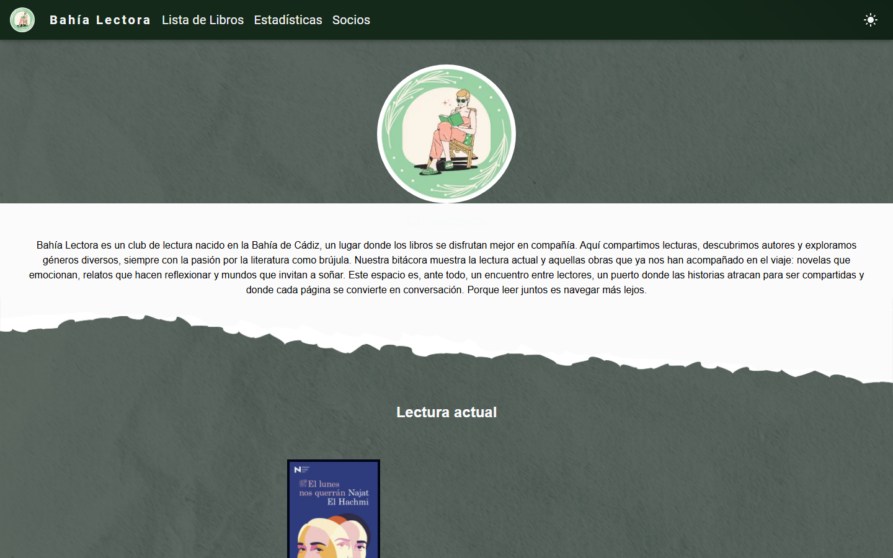

# Bahía Lectora

Website for a book club, live at **[bahia-lectora.jzmarquez.com](https://bahia-lectora.jzmarquez.com/)**. It shows the book the club is reading now, where the next meeting is, every book read so far with the members' ratings, and a random draw to pick the next one.




## How it works

The club manages everything in a Google Sheet, so nobody needs an admin panel:

1. **At build time**, `scripts/fetchBooksData.js` reads the votes (`Libros`), the current book (`Actual`) and book titles/authors (`Medias`) from Google Sheets, computes each book's average rating and fills in covers and other details from the **Google Books API**. The `Medias` table pairs `titulo` with `autor`; that author is used to find the right edition and takes precedence over Google Books metadata. `Actual` can contain `Título` and `Autor` columns; its author takes precedence for the current book. Results are cached by title, so unchanged books don't hit the API again.
2. It writes everything to `src/data/books.json`, which is the initial data and supplies book details such as covers.
3. A Netlify Function checks the `Libros`, `Actual` and `Medias` tabs when a visitor opens the site and once per minute while it stays open. It reads the publicly readable sheets through Google's Visualization endpoint; the browser never contacts Sheets directly.

Changes to those sheets appear within about a minute on an open page, or on the next visit. The function rereads the three tabs for each check and recomputes the site data. Changes to a title or author also refresh the affected book's Google Books metadata when `GOOGLE_API_KEY` is configured.

## Features

- Current book with a Google Maps view of the meeting place
- Full history of books read, with filters and per-book pages (with their own Open Graph tags for sharing)
- Member and statistics pages
- Random book draw
- Dark mode

## Getting started

```bash
npm install
npm start           # regenerates src/data/books.json and starts the dev server
npm run build       # regenerates the data and builds to build/
npm run preview     # serves the production build locally
npm run fetch-books # only regenerates src/data/books.json
```

Create a `.env` file with:

| Variable | Used for |
|---|---|
| `GOOGLE_SHEETS_API_KEY` | Optional; uses the official Sheets API, with the public endpoint as fallback |
| `GOOGLE_API_KEY` | Optional; Google Books metadata enrichment during builds and when new titles load |
| `GOOGLE_TRANSLATE_API_KEY` | Optional; translates imported descriptions and unrecognized categories into Spanish. Common Google Books categories are translated locally. If omitted, `GOOGLE_API_KEY` is reused |
| `GOOGLE_BOOK_SHEET_ID` | Spreadsheet ID used by builds and the live function |
| `BAHIA_SHEETS_ID` | Legacy spreadsheet ID; used only if `GOOGLE_BOOK_SHEET_ID` is unset |
| `VITE_GOOGLE_MAPS_EMBED_KEY` | Google Maps embed on the home page (shipped to the browser, so restrict it by HTTP referrer) |
| `ADMIN_USERNAME` / `ADMIN_PASSWORD` | Required in Netlify to protect `/admin` with HTTP Basic Auth |

The private `/admin` page has a button to reread all three book tabs immediately.
Set `ADMIN_USERNAME` and `ADMIN_PASSWORD` in Netlify's environment variables;
the page returns an error until both are configured. `GOOGLE_API_KEY` enables
Google Books enrichment for new books and changes to title/author data.

The existing `Medias` tab should have three columns, in this order: `Título`, `Autor`, `Media`. Add one book per row by entering its title and author; `Media` is calculated from the votes. The title identifies the book and should match its column in `Libros`. The `Libros` headers and average formulas are prefilled for up to 49 books, so no second title entry or extra tab is needed. ISBN is not required. If an author is missing, the site falls back to a title-based Google Books lookup.

See [WARP.md](WARP.md) for the full architecture notes.

## Deployment

Netlify runs `npm run build` and publishes `build/`. The build and Netlify Function use the same spreadsheet; set `GOOGLE_BOOK_SHEET_ID` under *Site configuration → Environment variables* to select it. `BAHIA_SHEETS_ID` is supported as a legacy fallback. `GOOGLE_SHEETS_API_KEY` is optional but preferred for the official Sheets API. `GOOGLE_API_KEY` enables Google Books metadata enrichment during builds and for newly added titles at runtime. Common categories are translated locally; enable Cloud Translation and set `GOOGLE_TRANSLATE_API_KEY` to translate descriptions and other category labels. The Google Books key is used as a fallback.
